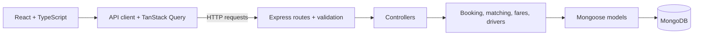
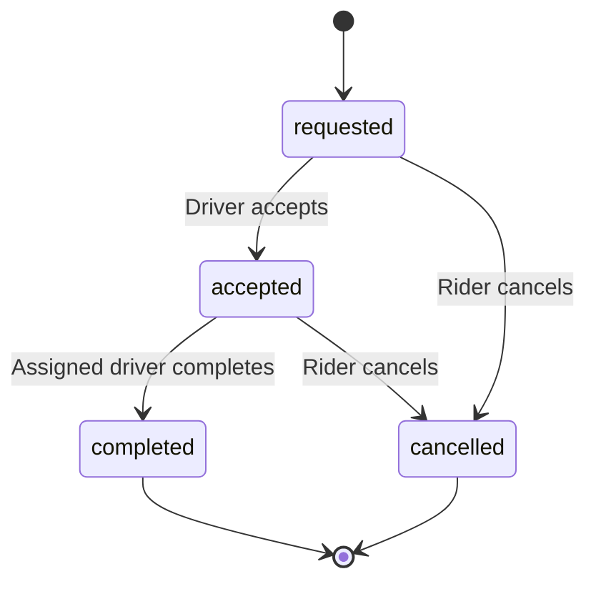

# Architecture & design notes

## Diagram



The backend follows a simple structure:

```text
Routes → Controllers → Services → Models
```

Routes define the endpoints and attach validation. Controllers handle HTTP input and output. Services contain the booking rules, and models handle database access.

Ride transitions are defined in `backend/src/domain/rideStateMachine.js`:



## 1. Why this stack and architecture?

I treated this as a focused assignment rather than a complete ride-hailing platform. The main goal was to demonstrate the booking flow, API validation, driver assignment, error handling, and protection against duplicate or competing requests.

I chose Express.js because it was enough for that scope. It allowed me to keep the backend small and make the request flow easy to follow. I still separated routes, controllers, services, and models so the business logic would not end up inside route handlers.

For a larger application maintained by a team, my starting preference would be NestJS. Its modules, dependency injection, guards, and TypeScript support would help keep authentication, booking, drivers, and other features organized as the codebase grows. That would be a maintainability choice; Express itself is also capable of running production applications.

MongoDB works for this task because ride details fit naturally into documents, and its geographic indexes support nearby-driver searches. Conditional updates and unique indexes provide the concurrency protection used here.

For a full application with payments, refunds, driver payouts, and related records, I would prefer PostgreSQL as the main transactional database. Transactions, constraints, and row-level locking would help enforce those relationships. PostgreSQL would not automatically remove race conditions—the queries and transaction boundaries would still need to be designed correctly.

I would introduce Redis for specific needs such as shared rate limiting, short-lived cached data, or frequently updated driver locations. I would not use a cached availability value as the final authority for assigning a ride.

Authentication would also be different in a real application. I would use short-lived JWT access tokens with a controlled refresh-token flow instead of trusting rider and driver IDs supplied by the client.

For this assignment, the smaller stack keeps attention on the booking behavior without adding infrastructure that the task does not yet need.

## 2. How do you prevent two drivers accepting the same ride?

I did not rely on disabling frontend buttons to prevent conflicting assignments. Requests can arrive from different browsers at the same time, so the final checks happen in the database.

The acceptance flow in `backend/src/services/ride.service.js` uses two conditional updates.

1. **Claim the driver.** Update the driver only if they are still available and have the correct category. Set their status to `busy` and store the ride ID.
2. **Claim the ride.** Update the ride only if it is still `requested`. Set its status to `accepted` and assign the driver.

If two drivers accept the same ride, only one can successfully change its status from requested to accepted.

If one driver tries to accept two rides, only one request can successfully change that driver from available to busy.

When the second update fails, the service releases the driver it claimed. The release checks that the driver is still linked to that particular ride.

This handles competing requests, but the two updates are not one transaction. A process failure between them can leave inconsistent data. Completing or cancelling a ride also involves a separate driver-release operation.

For a production implementation, I would put the related updates inside a transaction and enforce the relevant uniqueness rules in the database. With PostgreSQL, that could involve conditional updates or row locks, supported by constraints. I would also handle deadlocks or transaction conflicts with bounded retries.

The current tests cover multiple drivers competing for one ride, one driver competing for multiple rides, and acceptance happening at the same time as cancellation.

## 3. Retries and duplicate requests

A network failure does not necessarily mean the backend failed to save the ride. The server may have completed the request before the response was lost.

To handle this, `POST /rides` requires an `Idempotency-Key`.

The database has a unique index on:

```text
rider + idempotencyKey
```

When the same rider retries the same booking with the same key, the backend returns the existing ride instead of creating another one.

The responses are:

- `201` when a ride is created.
- `200` with `Idempotent-Replayed: true` when an existing booking is returned.
- `422 IDEMPOTENCY_KEY_REUSED` when the key is reused with different booking details.

A hash of the booking fields is stored to detect that last case.

The frontend keeps the same key when retrying. It generates a new one when the trip details change or the rider starts another booking.

A second partial unique index limits each rider to one active ride, even when different keys are used.

Accept, complete, and cancel do not use the same replay mechanism. Once a transition has happened, repeating it normally returns a conflict. After an uncertain response, the client should fetch the current ride state.

In a larger system, I would also define how long idempotency records are retained and apply the same care to payment-related operations.

## 4. How the frontend handles API failures

The frontend uses one shared HTTP client so error handling stays consistent across pages.

Network failures, timeouts, and unsuccessful HTTP responses become `ApiError` objects. A status value of `0` is an internal frontend marker for network or timeout failures; it is not an HTTP response code.

The client uses a 10-second abort timer around the fetch call.

The interface handles failures according to the operation:

- If an estimate fails, it shows an error and offers a retry when appropriate.
- If booking fails, the selected locations and category stay in the form.
- If status polling fails, the last known ride details remain visible with a refresh warning.
- If cancellation fails, the ride is fetched again because its status may have changed.
- If a saved ride ID returns 404, the page clears it and returns to the booking form.

The app polls active ride details approximately every three seconds. I used polling because it is straightforward for this task. For a real driver and rider application, I would consider WebSockets or server-sent events for faster updates and fewer repeated requests.

Live events would still need reconnect and resynchronization behavior. The client should be able to fetch the current ride state after missing an event.

## 5. Scaling to multiple cities and thousands of concurrent users

I would measure the workload before adding more infrastructure. Useful starting points would be request latency, geographic-query performance, database load, and the frequency of driver location updates.

For multiple cities, I would add a city identifier and city-specific configuration for service boundaries, fares, and matching distance.

The API could run across several instances behind a load balancer. Shared features such as rate limiting would then need shared storage instead of the current per-process default.

Driver locations would become a separate concern once they update continuously. Redis could support nearby-driver discovery or short-lived location data, while the main database keeps durable ride and assignment records.

Any cached or geographic search result would be treated as a candidate list. The final assignment would still need a database check because availability can change between searching and accepting.

I would also replace the current distance approximation with a routing provider for road-based pickup estimates. Straight-line proximity alone does not always identify the driver who can arrive first.

Reporting and historical queries could be separated from the booking workload when they begin affecting it.

## 6. When to introduce Redis, a broker, or separate services

I would add these tools when they solve a specific problem.

**Redis**

Possible uses include shared rate limiting, frequently read cached data, and temporary driver-location data. Cache entries would need clear expiry and invalidation rules.

I would avoid making Redis locks the only protection against double assignment. Durable database rules would remain the final safeguard.

**Message broker**

A broker would be useful for notifications, offer timeouts, analytics, and other work that should continue after an HTTP response.

If a database change must also publish an event, I would consider an outbox pattern. Consumers would need to tolerate repeated messages because delivery retries can produce duplicates.

**Separate services**

Location ingestion, matching, and payments may eventually have different scaling or operational needs. Those would be reasonable boundaries to consider.

For this task, a single backend with clear modules is easier to understand, test, and run.

## 7. Deploy, monitor, roll back

The repository currently includes Dockerfiles, Docker Compose, structured logging, and a health endpoint. A production delivery pipeline is not implemented.

**Deployment**

I would build a pipeline that runs type checks, tests, and the frontend build before publishing versioned images.

Configuration and secrets would be supplied by the deployment environment. Database changes would be reviewed separately, particularly index changes that could affect existing data or query performance.

**Monitoring**

The backend uses Pino and includes a request ID in responses.

For production, I would monitor:

- Error rates and response times.
- Time from ride request to acceptance.
- Requests rejected because no driver is available.
- Drivers marked busy without a valid assigned ride.
- Database query latency and connection health.

These measurements would help distinguish a slow endpoint from a broken booking flow.

**Rollback**

Versioned images would allow the previous application version to be redeployed. Database changes would need to remain compatible during the rollout.

I would use staged schema changes rather than assume that rolling back application code also reverses stored data changes.

## 8. Top three improvements before production

1. **Real authentication and authorization**

   I would replace client-supplied identities with authenticated users.

   My preferred approach would use short-lived JWT access tokens and refresh tokens that can be rotated and revoked. For a browser client, refresh tokens could be kept in secure, HttpOnly cookies with appropriate CSRF protection.

   Authorization would be checked on the backend. Riders should access only their own rides, eligible drivers should accept open requests, and only the assigned driver should complete a ride.

2. **Transactional consistency and recovery**

   I would make ride assignment and driver availability updates consistent across failures, using transactions and database constraints.

   I would also add expiry for requests that never receive a driver and a recovery process for inconsistent records. The current availability check does not guarantee that someone will accept the ride.

3. **Operational readiness and realistic location data**

   I would add CI/CD, monitoring, load tests, and tested backup procedures.

   Live driver locations, a routing provider, and reliable status updates would be necessary before treating the app as a real booking service.

## Assumptions

- Lahore is the only supported city, validated using a bounding box.
- All fares are in PKR.
- Pickup and destination must be at least 200 metres apart.
- Road distance is approximated as geographic distance multiplied by 1.3 and rounded to one decimal place.
- Fares use a base charge and a per-kilometre rate, rounded up to the next PKR 10, with a category minimum.
- Pickup ETA assumes an average speed of 25 km/h, applies the road-distance factor, and has a two-minute minimum.
- An eligible driver must be available nearby when the ride is requested.
- Checking availability does not reserve that driver.
- Requested rides currently have no automatic expiry.
- Cancellation is allowed while a ride is requested or accepted, with no cancellation fee.
- Places and driver locations are demo data.
- The driver page simulates the driver side of the application.
- Payments, live navigation, and production authentication are outside the current implementation.